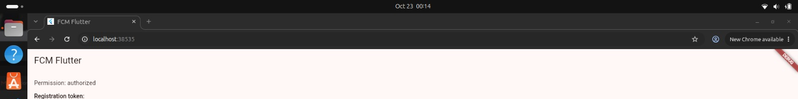
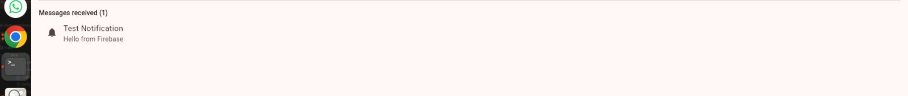

# FCM Flutter

A Flutter web app that receives push notifications with Firebase Cloud Messaging
(FCM). Built from the Firebase codelab
[Add push notifications to a Flutter app](https://firebase.google.com/codelabs/firebase-fcm-flutter).
That codelab covers push notifications (FCM), not login.

## What it does

- Asks the browser for notification permission and shows the result
- Gets this browser's FCM registration token and shows it, with a copy button
- Lists messages that arrive while the app tab is open
- Shows a browser notification when a message arrives while the tab is in the
  background (handled by a service worker)

## Screenshots

The registration token is left out of the screenshots on purpose.

| Permission granted | Message received |
|---|---|
|  |  |

## Setup

1. Create a project in the Firebase Console.
2. Install the Firebase CLI and FlutterFire CLI, then log in:

        firebase login
        dart pub global activate flutterfire_cli

3. From this folder, generate the Firebase configuration for web:

        flutterfire configure --platforms=web

4. In the Firebase Console go to Project settings, then Cloud Messaging, then
   Web Push certificates, and generate a key pair. Put that key in `lib/main.dart`
   as `vapidKey`.
5. Run the app and click Allow when the browser asks about notifications:

        flutter pub get
        flutter run -d chrome

## Testing it

Copy the registration token from the app. In the Firebase Console open
Messaging, create a notification message, choose Send test message, paste the
token and click Test.

- With the app tab focused, the message appears in the "Messages received" list.
- With another tab or window focused, the browser shows a notification.

I tested both cases and both worked.

## What I learned

- A web app needs a **service worker** (`web/firebase-messaging-sw.js`) to
  receive messages when the tab isn't in focus.
- The **VAPID key** identifies this web app to the browser's push service.
- **Foreground and background delivery** are handled in different places:
  `FirebaseMessaging.onMessage` inside the app, and the service worker outside it.
- `flutterfire configure` generates `lib/firebase_options.dart`, so the
  Firebase settings don't have to be copied by hand.
- The FCM registration token identifies one browser on one device and can
  change, so the app listens for `onTokenRefresh`.

## Tech used

- Flutter and Dart
- `firebase_core` and `firebase_messaging`
- Firebase Cloud Messaging
