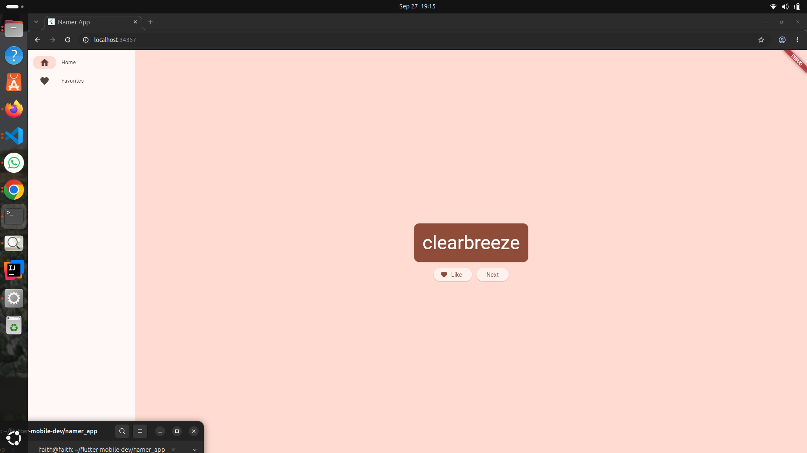
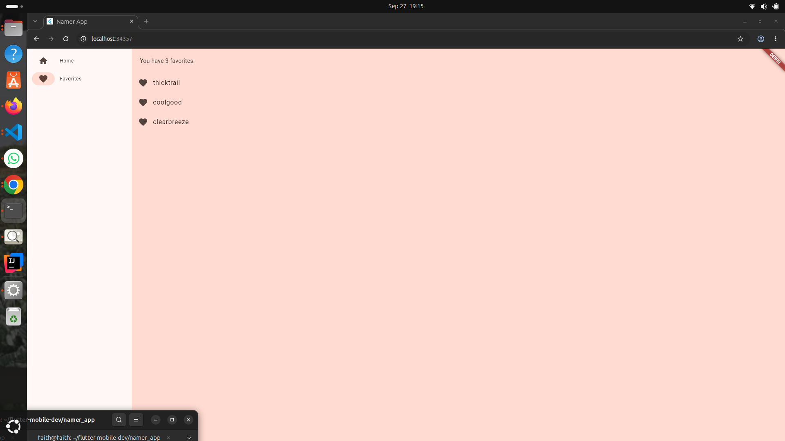

# Namer App

A Flutter app that generates random word-pair name ideas, lets you favorite the
ones you like, and browse your favorites on a separate page. Built as part of
the [Your First Flutter App](https://codelabs.developers.google.com/codelabs/flutter-codelab-first)
codelab.

## What it does

- Generates a random word pair (e.g. "massjob", "hornstreak") on load
- **Next** button generates a new random pair
- **Like** button saves/unsaves the current pair to a favorites list
- A responsive navigation rail switches between the generator and a
  Favorites page listing everything you've liked
- The nav rail automatically shows text labels next to its icons once the
  window is wide enough (≥600px), and just icons on narrower screens

## Screenshots

| Home | Favorites |
|---|---|
|  |  |
## Running it

    flutter pub get
    flutter run -d chrome

This project was developed and tested against Chrome. It should also run on
Linux desktop, Android or iOS if the matching toolchain is installed.

## What I learned

- **Widgets are the building blocks.** Even the app itself (`MyApp`) is a
  widget, and the UI is built by combining small widgets (`Card`, `Padding`,
  `Row`, `Column`) instead of configuring one big object.
- **App-wide state with `ChangeNotifier`.** The current word pair and the
  favorites list live in `MyAppState`. Any widget that calls
  `context.watch<MyAppState>()` rebuilds when `notifyListeners()` fires.
- **`StatelessWidget` vs `StatefulWidget`.** Most widgets here are stateless
  because they only display data owned elsewhere. `MyHomePage` is stateful
  because it remembers which navigation rail item is selected, which is local
  state that doesn't belong in the app-wide state.
- **Hot reload vs hot restart.** Hot reload (`r`) keeps the app's state while
  swapping in new code. Hot restart (`R`) rebuilds from scratch. A syntax error
  blocks both, so the terminal output is where to look when a change doesn't
  show up.
- **Responsive layout with `LayoutBuilder`.** The navigation rail shows labels
  only when the window is at least 600px wide.

## Tech used

- Flutter (stable channel) and Dart
- `english_words` for generating word pairs
- `provider` for state management
